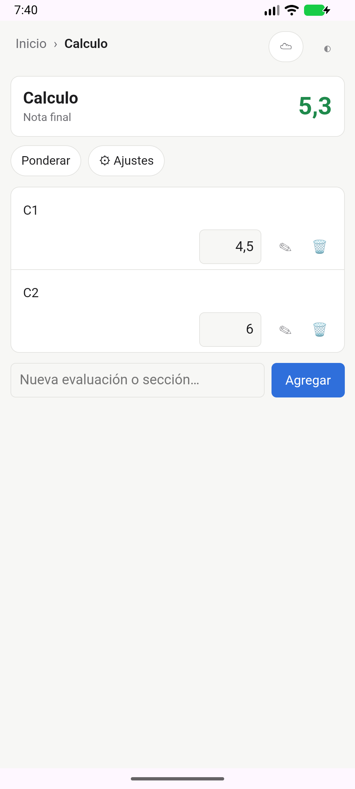
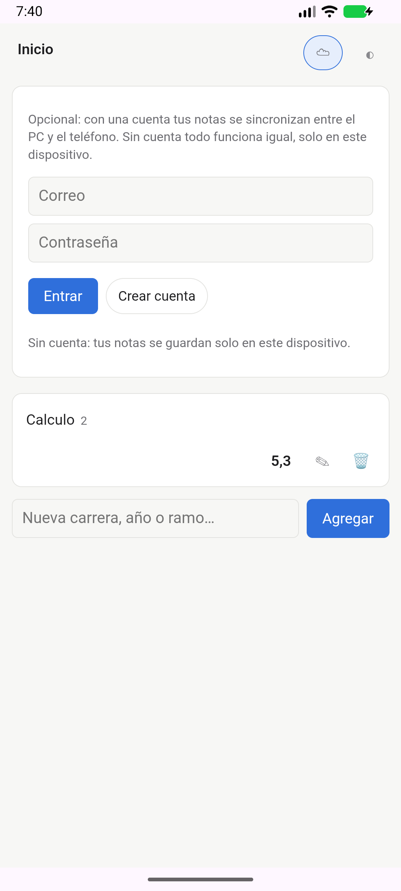

# Notable

Gestor de notas y calificaciones para **PC (Windows, Linux) y Android**, escrito en Rust.
Arma tu carrera, tus ramos y sus evaluaciones como quieras, ingresa las notas y Notable calcula
tus promedios y cuánto necesitas para llegar a la nota que buscas.

<p align="center">
  
  &nbsp;&nbsp;
  
</p>

- **Local primero:** funciona completo sin internet y sin cuenta.
- **Simple por defecto:** los promedios son simples; el botón **Ponderar** activa pesos (también
  "vale 20 % del ramo", respecto a otro nivel).
- **Todo configurable:** escala (1,0–7,0, 0–100 o la que quieras), decimales, aproximar o truncar,
  redondear en cada nivel, conversión entre escalas.
- **Nota objetivo:** "Necesitas 4,3 en el Certamen 2".
- **Reglas opcionales** (apagadas hasta que las actives): eliminar las peores notas, examen que
  reemplaza a la peor, eximición, nota mínima para aprobar, promedio por créditos.
- **Sincronización opcional** entre dispositivos con una cuenta (correo y contraseña).
- Tema claro/oscuro y diseño para teléfono.

## Instalar

Descarga la última versión desde [Releases](https://github.com/malvarezdam/Notable/releases/latest):

| Sistema | Archivo |
|---|---|
| Windows | `Notable_…_x64-setup.exe` (o el `.msi`) |
| Linux | `.AppImage` (dale permiso de ejecución) o `.deb` |
| Android | `Notable-…-android-arm64.apk` (casi todos los teléfonos; `armv7` para los muy antiguos) |

**Android:** abre el `.apk` en el teléfono y permite "instalar apps desconocidas" para la app
desde la que lo abriste (navegador, Drive…). Para actualizar, instala el nuevo encima: tus notas
se conservan.

**Windows:** si aparece "Windows protegió tu PC", pulsa *Más información → Ejecutar de todas
formas* (el instalador no está firmado con un certificado de pago).

## Cómo se usa

1. **Agrega** lo que quieras organizar: una carrera, un año, un semestre o directamente un ramo.
   Entra a cada uno y agrega sus evaluaciones o secciones (por ejemplo, "Certámenes" con sus
   certámenes adentro). Los nombres los pones tú: todo es un árbol.
2. **Ingresa las notas** en las evaluaciones. Cada nivel muestra su promedio con lo que hay
   ("nota parcial") hasta que estén todas ("nota final").
3. ¿Las evaluaciones no valen lo mismo? Pulsa **Ponderar** y escribe el % de cada una.
4. En **⚙ Ajustes** de cada nivel: nota objetivo, escala, redondeo, créditos y, plegadas,
   las **reglas opcionales**.
5. Opcional: pulsa **☁** para crear una cuenta y sincronizar el PC y el teléfono. Sin cuenta,
   todo se guarda solo en el dispositivo.

## Compilar

Requiere Rust (estable), el objetivo `wasm32-unknown-unknown`, [Trunk](https://trunkrs.dev) y
la CLI de Tauri 2 (`cargo install tauri-cli --version "^2"`).

```bash
cargo test --workspace --exclude notable-ui   # pruebas
cd app/src-tauri && cargo tauri dev           # la app en modo desarrollo
cd app/src-tauri && cargo tauri build         # instalador de escritorio
```

Para Android y la configuración de Supabase, ver [docs/CONFIGURACION.md](docs/CONFIGURACION.md).
El plan de desarrollo y las decisiones están en [PLAN.md](PLAN.md).

| Carpeta | Qué hay |
|---|---|
| `crates/notable-core` | Modelo (árbol de nodos), cálculo, nota mínima y reglas. Sin IO. |
| `crates/notable-store` | Guardado local en SQLite y respaldo en JSON. |
| `crates/notable-sync` | Cuenta y sincronización con Supabase. |
| `crates/notable-api` | Tipos que intercambian la app y la interfaz. |
| `app/` | Interfaz (Leptos, WebAssembly). `app/src-tauri/`: la app (Tauri 2, escritorio y Android). |
| `supabase/schema.sql` | Esquema del servidor. |

## Licencia

[MIT](LICENSE)
